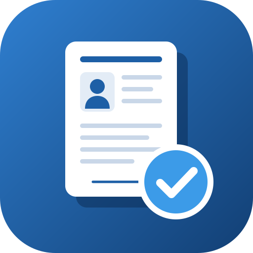
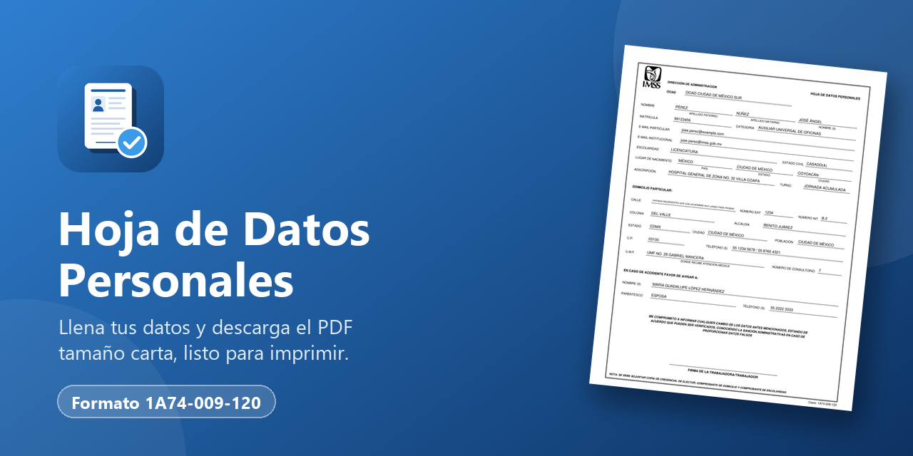
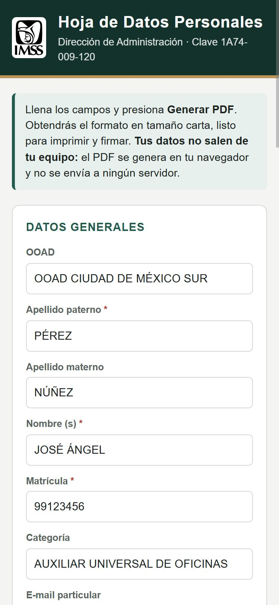
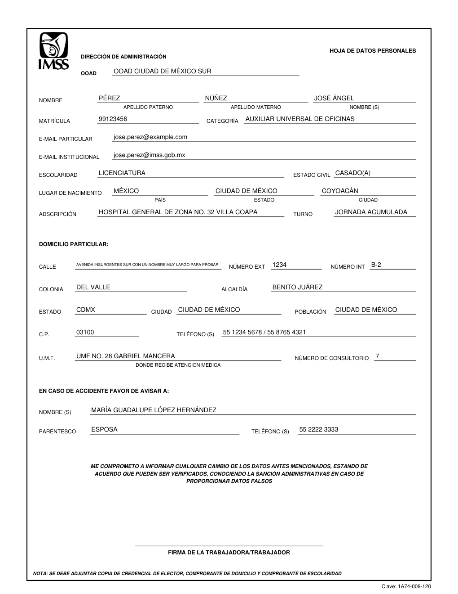

<p align="center">
  
</p>

<h1 align="center">Hoja de Datos Personales</h1>

<p align="center">
  Llena la <strong>Hoja de Datos Personales</strong> del IMSS (formato 1A74-009-120) desde el celular o la computadora y descárgala en PDF tamaño carta, lista para imprimir y firmar.
</p>

<p align="center">
  <a href="https://davmz86.github.io/hoja-datos-personales-2026/"><strong>Abrir la aplicación →</strong></a>
</p>

<p align="center">
  <a href="https://davmz86.github.io/hoja-datos-personales-2026/"></a>
</p>

---

Hoja de Datos Personales es una herramienta web gratuita y de uso libre para trabajadoras y trabajadores del Instituto Mexicano del Seguro Social. Captura tus datos generales, tu domicilio y el contacto en caso de accidente, y obtén la hoja ya requisitada en el mismo diseño del formato impreso, con las líneas, leyendas y la clave 1A74-009-120.

Es un proyecto independiente hecho por un trabajador del IMSS para sus compañeros. **No es una herramienta oficial del IMSS** ni está respaldada por el Instituto. El formato y su logotipo pertenecen al IMSS; esta aplicación solo escribe tus datos sobre él.

<p align="center">
  
  &nbsp;&nbsp;
  
</p>
<p align="center"><sub>Formulario y PDF resultante. Los datos mostrados son ficticios.</sub></p>

## Cómo usarlo

1. Abre **[davmz86.github.io/hoja-datos-personales-2026](https://davmz86.github.io/hoja-datos-personales-2026/)** en cualquier navegador.
2. Llena **Datos generales**: OOAD, nombre, matrícula, categoría, correos, escolaridad, estado civil, lugar de nacimiento, adscripción y turno. Los campos con `*` son obligatorios.
3. Llena **Domicilio particular**: calle, números, colonia, alcaldía, estado, ciudad, C.P., teléfonos, U.M.F. y consultorio.
4. Llena **En caso de accidente favor de avisar a**: nombre, parentesco y teléfono.
5. Pulsa **Generar PDF** para descargarlo, o **Vista previa / imprimir** para abrirlo e imprimirlo directamente.
6. Firma a mano y entrégalo con las copias que pide la nota del formato: credencial de elector, comprobante de domicilio y comprobante de escolaridad.

### Al imprimir

- Usa hoja **carta** y escala **100 % / tamaño real**. La opción "ajustar a la página" puede desalinear el texto respecto a los renglones.
- La firma se deja en blanco a propósito: debe ser autógrafa.
- Verifica con tu área de personal que el formato impreso se acepte en tu unidad.

## Tus datos y privacidad

Todo ocurre dentro de tu navegador. La aplicación **no tiene servidor, no envía tus datos a ningún lado, no los guarda y no usa cuentas ni rastreadores**. El PDF se genera en tu propio dispositivo. Al cerrar o recargar la página, los datos capturados se borran.

## Problemas y sugerencias

Si algo sale encimado, cortado o fuera de su renglón, [abre un reporte](https://github.com/DaVmZ86/hoja-datos-personales-2026/issues) e incluye:

- El navegador y dispositivo que usaste (por ejemplo, Chrome en Android o Safari en iPhone).
- Qué campo se ve mal y una captura del PDF.
- Si usaste mayúsculas automáticas y si imprimiste a tamaño real.

Limitaciones conocidas: los textos muy largos se reducen de tamaño para caber en su renglón, y los caracteres que la fuente del PDF no admite (algunos símbolos o emojis) se omiten. La biblioteca que genera el PDF se carga de internet, así que la página necesita conexión.

## Desarrollo y contribuciones

No hay instalación ni dependencias para usar la app: es un sitio estático.

```
├── index.html                  Formulario
├── css/styles.css              Estilos
├── js/app.js                   Llenado de la plantilla con pdf-lib y descarga del PDF
├── js/plantilla-data.js        Plantilla PDF incrustada en Base64 (generado)
├── assets/plantilla.pdf        Plantilla tamaño carta con campos rellenables (generado)
├── assets/logo.svg             Icono del proyecto (también favicon e iconos PNG)
├── assets/portada.png          Portada para el README y vista previa en redes
├── tools/generar_plantilla.py  Genera la plantilla y plantilla-data.js
└── .github/workflows/pages.yml Publicación automática en GitHub Pages
```

- **Campos**: cada `name` del formulario en `index.html` corresponde a un campo de la plantilla PDF.
- **Plantilla**: si cambias el diseño o agregas un campo, edita `tools/generar_plantilla.py` y regenera:

  ```bash
  pip install reportlab
  python tools/generar_plantilla.py
  ```

- **Publicación**: cada `push` a `main` vuelve a publicar el sitio en GitHub Pages en uno o dos minutos.

Para probar cambios, abre la app localmente, genera un PDF con datos ficticios y compáralo impreso contra el formato en papel. No subas al repositorio PDF llenados con datos reales: `.gitignore` ya excluye los archivos `Hoja_Datos_Personales_*.pdf`.

## Créditos y licencia

Creado por **DaVmZ86**

El PDF se genera con [pdf-lib](https://github.com/Hopding/pdf-lib) (licencia MIT, © Andrew Dillon), que se carga desde un CDN.

El código de esta aplicación se publica bajo la licencia MIT; consulta [LICENSE](LICENSE). El formato "Hoja de Datos Personales" (clave 1A74-009-120), su diseño y el logotipo del IMSS son propiedad del Instituto Mexicano del Seguro Social y no forman parte de esa licencia.
